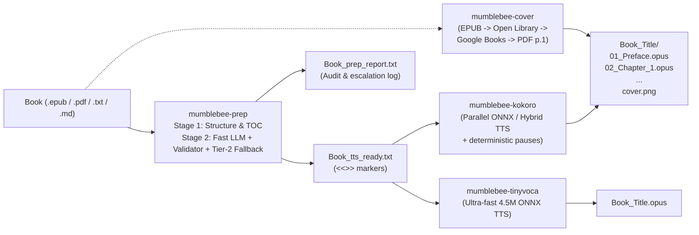

# mumblebee

**Turn messy PDFs, EPUBs, and OCR'd books into clean, chaptered, cover-tagged local audiobooks.**

`mumblebee` pairs a **local LLM copy-editor** with **parallel, lossless ONNX TTS** ([Kokoro-82M](https://huggingface.co/hexgrad/Kokoro-82M) and [tiny-voca](https://github.com/n4ze3m/tiny-voca)) to turn real-world books—not just pristine novels, but academic non-fiction and noisy 1980s OCR scans—into pleasant, uninterrupted `.opus` audiobooks with chapter files, metadata tags, and `cover.png` art ready for players like [Voice (F-Droid)](https://f-droid.org/packages/de.ph1b.audiobook/) and Audiobookshelf.

---

## Motivation

If you have ever piped a real PDF or non-fiction EPUB straight into a text-to-speech engine, you know how quickly the listening experience falls apart:

- The narrator reads running headers and page numbers right in the middle of a sentence (*"…the cranial flexure ASHLEY MONTAGU 12 Growing Young is retained…"*).
- Footnote numbers glued to words (`century14`), bottom-of-page footnotes, parenthetical citations, floating tables, and multi-page figure captions/diagram labels interrupt the prose.
- OCR'd books scatter mid-word splits (`Sometim es`, `ad u lth oo d`, `A n n a  H e m p s t e a d`) that sound like gibberish when spoken aloud.
- Chapter titles slam directly into the first sentence with zero pause—or get spoken twice—and 80 pages of endnotes, bibliographies, and indexes trail onto the end of the book.

Meanwhile, cloud audiobook/TTS services are expensive, upload your personal library to third-party servers, and still struggle with messy PDF layouts.

`mumblebee` exists to make **local, private, high-craft audiobook conversion** practical on your own machine: clean the text semantically *without ever rewriting the author*, verify the result with automated quality checks, and synthesize fast, cleanly paced chapters in lossless FP32.

---

## Goals & Non-Goals

### Goals
- **100% verbatim prose preservation**: Strip print clutter and repair OCR scars without summarizing, paraphrasing, abridging, or inventing words.
- **Auditable, decoupled pipeline**: Produce a clean, human-readable `*_tts_ready.txt` and `*_prep_report.txt` before audio synthesis. Audit the text once; re-render cheaply with any voice, pacing, or TTS engine.
- **Thoughtful audiobook mastering out of the box**:
  - Deterministic silence beats after chapter titles (`1.2s`), standalone subheadings/epigraphs (`0.7s`), and paragraphs (`0.45s`), plus a `0.25s` lead-in.
  - Automatic chapter title deduplication so headings aren't spoken twice or glued onto the opening sentence.
  - Native `1.0×` speech speed by default so mobile players can speed up playback in a single pass without double time-stretching artifacts.
  - Compact Vorbis-tagged `.opus` chapters (`~13–14 MB/hour`) plus automatic `cover.png` lookup.
- **Fast & 100% local**:
  - Two-tier local LLM cleaning (fast small model in parallel + automatic validation & escalation to a stronger model only for tricky diagram/table chunks) cleans an 86k-word OCR PDF in ~15 minutes.
  - Parallel CPU ONNX Runtime TTS runs at **31–35× real-time** (Kokoro-82M) or **~1,150× real-time** (`tiny-voca`) using **0 MB GPU memory**, coexisting safely alongside a resident local LLM server (or **~40.5× RT** in Hybrid CPU+GPU mode when the GPU is free).
- **No vendor lock-in**: Works with any local OpenAI-compatible LLM endpoint (`llama-server`, Ollama, vLLM, LM Studio).

### Non-Goals
- **Not a DRM tool**: Bring your own DRM-free `.epub`, `.pdf`, `.txt`, or `.md` files.
- **Not a dramatic voice-cloning / multi-cast studio**: Focused on clean, dependable single-narrator long-form narration for non-fiction and fiction.

---

## Pipeline Overview



---

## Tools & Performance

Measured on an AMD Ryzen AI MAX+ 395 (16 Zen 5 cores / Radeon 8060S APU, 256 GB/s unified memory):

| CLI (and alias) | Purpose | Typical Speed |
|---|---|---|
| **`mumblebee-prep`** (`book-prep`) | Cleans `.epub`/`.pdf`/`.txt`/`.md` into a verbatim `*_tts_ready.txt` with `<<<BOOK_TITLE>>>`, `<<<BOOK_AUTHOR>>>`, and `<<<CHAPTER: ...>>>` markers plus an audit report. | ~100–130 agg tok/s (~15 min for an 86k-word OCR PDF via 4-slot `Qwen3-4B` + Tier-2 escalation) |
| **`mumblebee-kokoro`** (`kokoro-fast`) | Parallel Kokoro-82M TTS producing one Vorbis-tagged `.opus` file per chapter + `cover.png`, with deterministic chapter/heading/paragraph pauses. | **~31–35× RT** (ONNX CPU FP32, 0 MB GPU) / **~40.5× RT** (Hybrid CPU+ROCm) |
| **`mumblebee-tinyvoca`** (`tiny-voca-fast`) | Ultra-fast 4.5M-parameter parallel ONNX TTS (`M2`/`F2` voices) with pacing controls, live progress bars, and tagged `.opus` output. | **~1,150–1,200× RT** synthesis (~850× RT end-to-end WAV) |
| **`mumblebee-cover`** (`fetch-book-cover`) | Zero-API-key cover fetcher saving `cover.png`: embedded EPUB cover → Open Library → Google Books → PDF page 1 fallback. Also called automatically by `mumblebee-kokoro`. | ~1–2 s |

---

## Installation

Requires Python 3.10+, `ffmpeg` (with `libopus`), and `poppler-utils` (`pdftotext`, `pdftoppm`) for `.pdf` inputs.

```bash
git clone https://github.com/sergeyplis/mumblebee.git
cd mumblebee

# With Kokoro-82M TTS:
pip install -e ".[kokoro]"

# Or with tiny-voca TTS:
pip install -e ".[tiny-voca]"

# Or both:
pip install -e ".[all]"
```

---

## Usage

### 1. End-to-End (Book → Clean Text → Per-Chapter Opus + Cover)

Point `mumblebee-prep` at any OpenAI-compatible LLM server (`llama-server`, Ollama, vLLM, LM Studio, etc.). See [examples/strix-halo-llama-server.sh](examples/strix-halo-llama-server.sh) for a reference 4-slot `Qwen3-4B-Instruct` launcher.

```bash
mumblebee-prep MyBook.epub \
  --api-url http://127.0.0.1:8081/v1/chat/completions --model qwen3-4b-instruct \
  --fallback-api-url http://127.0.0.1:8080/v1/chat/completions --fallback-model qwen3.8-flash-next \
  --resume --tts kokoro --tts-output-dir ./books
```

Environment variables (`MUMBLEBEE_API_URL`, `MUMBLEBEE_MODEL`, `MUMBLEBEE_FALLBACK_API_URL`, `MUMBLEBEE_FALLBACK_MODEL`, `MUMBLEBEE_CACHE_DIR`, `MUMBLEBEE_FAST_SERVER_CMD`, `OPENAI_API_KEY`) can also be set so you don't have to pass URLs on every run.

### 2. Step-by-Step Workflow (Recommended for OCR PDFs)

#### Step A — Clean & Audit Text (`mumblebee-prep`)
```bash
# Clean an EPUB or PDF (keeps Preface/Intro, drops endnotes/bibliography/index):
mumblebee-prep MyBook.pdf --resume

# Keep narrative Appendices too:
mumblebee-prep MyBook.pdf --keep-appendices --resume

# Fast sanity test on the first 3 sections only:
mumblebee-prep MyBook.pdf --max-chapters 3 --resume
```
Review `MyBook_prep_report.txt` (shows any escalated or flagged chunks) and skim `MyBook_tts_ready.txt` before rendering audio.

#### Step B1 — Render Per-Chapter Opus with Kokoro (`mumblebee-kokoro`)
```bash
# Auto-detects <<<CHAPTER: ...>>>, title/author tags, cover.png, and safe backend:
mumblebee-kokoro --input MyBook_tts_ready.txt --output-dir ./books

# Customize voice, pauses, bitrate, or playback speed:
mumblebee-kokoro --input MyBook_tts_ready.txt \
  --voice af_heart \
  --chapter-pause 1.2 --heading-pause 0.7 --paragraph-pause 0.45 \
  --bitrate 32k --output-dir ./books

# Force 0-GPU ONNX CPU mode (~31-35x RT, leaves GPU free for LLMs):
mumblebee-kokoro --input MyBook_tts_ready.txt --backend onnx --output-dir ./books

# Force Hybrid CPU + GPU mode (~40.5x RT when GPU is free):
mumblebee-kokoro --input MyBook_tts_ready.txt --backend hybrid --output-dir ./books
```

#### Step B2 — Render with `tiny-voca` (`mumblebee-tinyvoca`)
```bash
mumblebee-tinyvoca \
  --text-file MyBook_tts_ready.txt \
  --voice M2 --speed 0.88 --sentence-pause 0.15 --paragraph-pause 0.45 \
  --bitrate 32k --artist "Author Name" --album "Book Title" --title "Book Title" \
  -o ./books/MyBook_M2.opus
```

#### Step C — Standalone Cover Fetch (`mumblebee-cover`)
```bash
mumblebee-cover --title "Growing Young" --author "Ashley Montagu" --pdf GrowingYoung.pdf -o ./books/Growing_Young/cover.png
```

---

## Design Reasoning (The "Why" Behind the Architecture)

These empirical lessons shaped every major design decision—recorded here because code alone rarely explains *why* alternatives were rejected:

### 1. Why LLM preprocessing instead of regex/grep
Real books—especially academic non-fiction and OCR'd PDFs—entangle layout noise semantically with prose. A regex cannot reliably tell whether `century14` is a footnote number or a measurement, cannot repair arbitrary OCR word splits (`ad u lth oo d`, `Sometim es`), cannot stitch a sentence interrupted mid-clause by a 20-line floating table or 4 pages of skull diagrams, and cannot distinguish a keep-worthy Preface from 80 pages of endnotes. Decoupling **`mumblebee-prep` → `*_tts_ready.txt` → TTS** lets you verify the text once and re-synthesize cheaply with any voice or engine.

### 2. Why two-tier LLM cleaning (fast 4B + validator escalation) beats one giant model
- On 256 GB/s unified memory, an ~85 GB frontier model is memory-bandwidth-bound (~24–32 tok/s, ~70 min/book). Verbatim copy-editing does not require frontier reasoning on 90% of chunks.
- A 4B instruction model (`Qwen3-4B-Instruct-2507` Q4_K_M, 2.4 GB) running **4 continuous-batching slots** achieves **~100–130 aggregate tok/s** (~15 min/book) inside ~3.5 GB VRAM/GTT.
- **Why `ngram-simple` speculative decoding was rejected**: Despite ~95% verbatim copying, OCR line wraps every ~10 words shattered n-gram matches (9% draft acceptance), wasting verify compute and stalling 4-slot continuous batching (~35 tok/s vs ~100–130 tok/s with pure `--cont-batching`).
- **Why automated chunk validation + Tier-2 escalation**: On the ~10% of chunks dominated by multi-page diagrams (`Fig. 1–5`, `PROBOSCIS MONKEY`, running headers) or subtle BPE-masked OCR splits (`Sometim es`, `L a Barre`, `A s`), a 4B model under a strict verbatim prompt can occasionally copy the artifact verbatim. `validate_cleaned_chunk()` checks every chunk for leaked headers/page numbers, `Fig.`/`TABLE` captions, ALL-CAPS diagram clusters, merged >650-word walls, broken lowercase paragraph starts, letter-spaced text (`A n n a ...`), and single-space mid-word OCR splits—then automatically escalates *only* failing chunks with concrete error feedback to the stronger fallback model.

### 3. Critical PDF & Chunking Traps We Hit and Fixed
- **Never use `str.splitlines()` on PDFs**: Python's `splitlines()` silently splits on and strips `\f` form-feed page breaks, blinding chapter detection. Always use `split("\n")`.
- **Never split chunks on `\f` page breaks**: Printed page breaks frequently cut mid-sentence or across floating tables. Splitting at `\f` causes small LLMs to hallucinate an ending for the dangling clause while the next chunk opens mid-air (`maximus (the large muscle...)`). Keep `<PAGEBREAK>` *inside* chunks and split only after blocks ending in terminal sentence punctuation whose next real prose line (skipping headers and page numbers) starts cleanly.
- **PDF paragraph restoration**: Non-layout `pdftotext` (required to de-column spreads) omits blank lines between paragraphs, causing LLMs to merge whole pages into 1,500-word walls. Re-inserting blank lines after short sentence-ending lines restores paragraphs before chunking.
- **Prefer `.epub` over `.pdf` whenever available**: Pure-stdlib EPUB extraction provides exact spine reading order, Dublin Core metadata, clean structural pre-stripping of `<figcaption>`, `<aside epub:type="footnote">`, and `<sup>` footnote markers (while preserving ordinals like `2nd`), plus the embedded publisher cover.

### 4. Deterministic Pacing & Clean Speed belong in the TTS Layer (Not the LLM)
- **Never rely on an LLM for audio timing**: Even if a heading loses a blank line or repeats the `<<<CHAPTER: ...>>>` title, `mumblebee-kokoro` deterministically strips duplicate leading chapter titles (with or without `Chapter N:` prefixes), appends terminal punctuation so Kokoro uses a clean falling intonation, and streams exact silence beats (`--lead-in`, `--chapter-pause`, `--heading-pause`, `--paragraph-pause`) straight into `ffmpeg`.
- **Why `--speed` defaults to `1.0`**: Baking `ffmpeg atempo=1.3` into a lossy `.opus` file and then listening at `1.2×` in an audiobook player applies WSOLA time-stretching *twice* across lossy compression. Generating at clean `1.0×` lets your player handle speed adjustment in a single pass with noticeably cleaner audio.

### 5. Why Parallel ONNX Runtime CPU Beats (or Ties) GPU for TTS
- **`tiny-voca` (4.5M params)**: Kernel-launch bound on GPU (~98–343× RT on Radeon 8060S). Running 1 single-threaded ONNX session per physical core (`16w × 1T`, pre-optimized `--optimized` + `ORT_ENABLE_ALL`, LPT longest-first scheduling, `dizione` frontend) hits **~1,150–1,200× RT** in lossless FP32 with 0 MB GPU.
- **`Kokoro-82M` on AMD ROCm / Strix Halo (`gfx1151`)**: Default PyTorch ROCm (`cudnn=True`) triggers a severe MIOpen workspace fallback (`705 MB required, provided 0`) on Kokoro's 1D transposed convolutions, stalling at **< 1× RT** even under `MIOPEN_FIND_MODE=FAST`. Disabling MIOpen (`torch.backends.cudnn.enabled = False`) + FP16 + 4–6 streams reaches ~31× RT (8 streams thrashes GTT). Meanwhile, **16-core ONNX Runtime CPU FP32** hits the same **~31–35× RT** with **0 MB GPU** (safe alongside a resident LLM), and **Hybrid (CPU ONNX + 4 GPU streams)** reaches **~40.5× RT** when the GPU is free.
- **Why INT8 ONNX was rejected for both models**: On `tiny-voca`, INT8 MatMul gave only +15% speed while altering durations on 115/119 sentences; on `Kokoro-82M`, INT8 was *slower* (21.4× vs 31.1× RT) and shifted 27/28 chunk lengths. Lossless FP32 won on both quality and reliability.

### 6. Why Opus (`32k` VBR, `-application voip`, 24 kHz mono)
Best speech intelligibility per megabyte (~13–14 MB/hour — ~3–4× smaller than MP3, ~12× smaller than WAV), native Vorbis tags (`title`, `artist`, `album`, `track`, `genre`, `comment`), and streaming PCM-to-`ffmpeg` piping that avoids multi-GB temporary WAV files.

---

## Running Tests

```bash
PYTHONPATH=src python -m unittest discover -s tests -v
```

## License

MIT — see [LICENSE](LICENSE).
